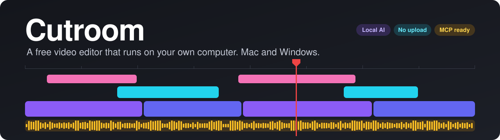
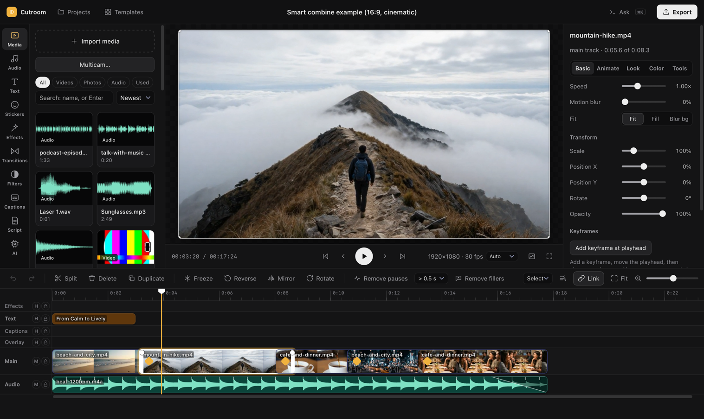
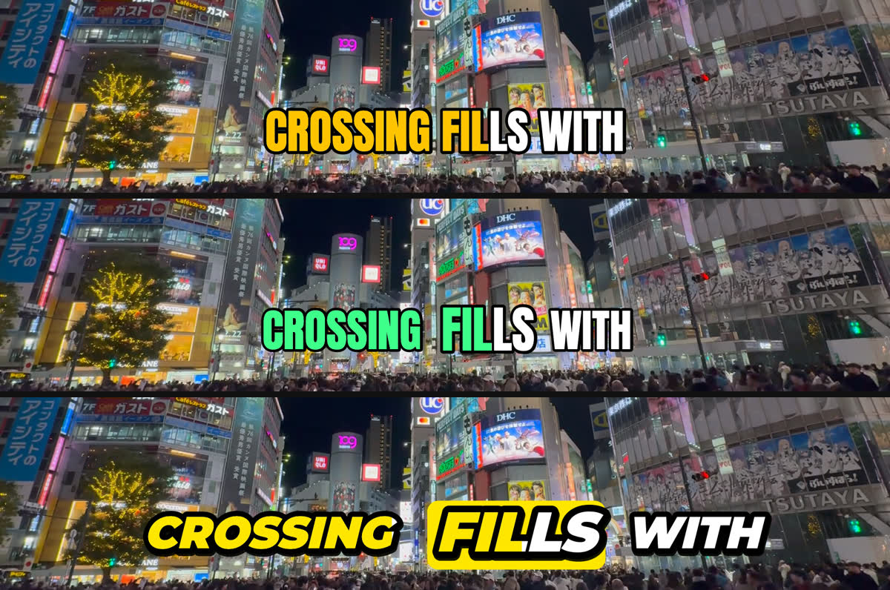
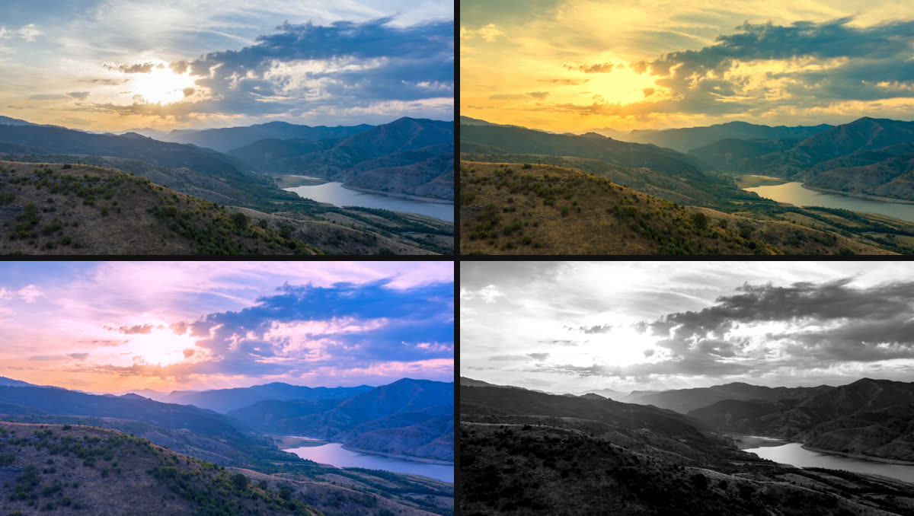
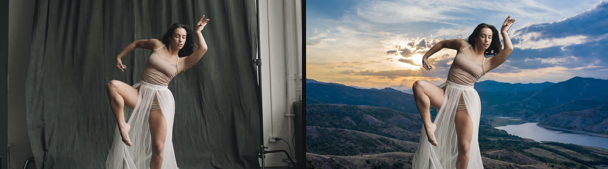
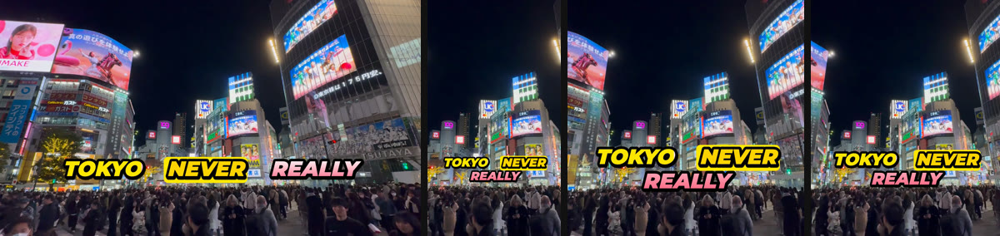
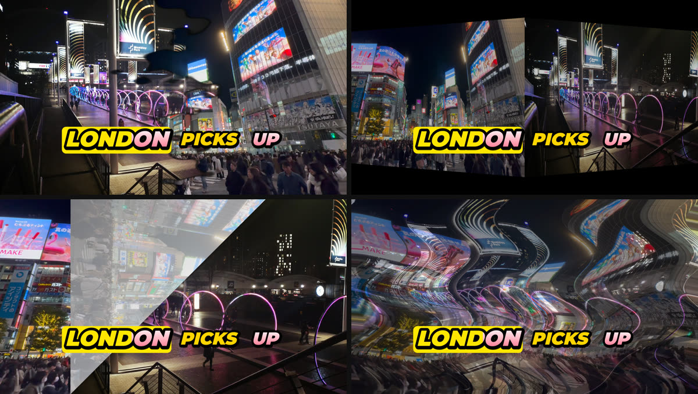

<p align="center"></p>

<p align="center">
  <a href="#install-in-one-line"></a>
  <a href="#install-in-one-line"></a>
  <a href="LICENSE"></a>
  <a href="docs/GUIDE.md#how-its-tested"></a>
  <a href="#let-your-ai-assistant-edit-mcp"></a>
  
</p>

<p align="center"><b>A free video editor for Mac and Windows that runs entirely on your computer.</b><br>
CapCut-style editing with AI built in. No account, no uploads, no watermark, no subscription.</p>

## Install in one line

** Mac** · paste into Terminal:

```sh
curl -fsSL https://raw.githubusercontent.com/NewAtThisdude/cutroom/main/install.sh | sh
```

** Windows 10 / 11** · paste into PowerShell:

```powershell
irm https://raw.githubusercontent.com/NewAtThisdude/cutroom/main/install.ps1 | iex
```

It checks your computer first, asks before installing anything and needs no admin rights. Run it again to update.
[Other ways to install](docs/GUIDE.md#install-in-detail) · [Uninstall](docs/GUIDE.md#uninstall)



## See what it makes

Every image below came out of Cutroom's own exports ([footage credits](docs/samples/CREDITS.md)).

**Auto captions** over an on-device voiceover, in three of the 22 caption styles



**Colour looks** in one click: the original, Golden, Cyber and Noir



**Cut out a subject** and put it on any background, no green screen



**Every shape from one edit**: 16:9, 9:16, 1:1 and 4:5, with captions that reflow to fit



**57 transitions**, here caught halfway: ink, cube, page curl and wave



## Why Cutroom

-  **Private.** Your footage never leaves your computer. No account, no cloud, nothing to pay.
-  **AI on your own machine.** Auto captions in 18 languages, voiceover, voice cloning, object removal,
  background cut-outs and music. The installer sets up what your hardware can run.
-  **What you see is what you export.** The preview and the export share one engine, and every release
  compares them frame by frame.
-  **A real editor.** Multi-track timeline, keyframes, colour wheels and LUTs, 57 transitions, and
  exports up to 8K with HDR and ProRes.
-  **Your AI assistant can edit.** Claude, Codex, Cursor or Copilot can cut, caption and export the open
  project while you watch.
-  **Tested on both systems.** 1,717 automated checks on a Mac and 1,849 on Windows before a release.

## Let your AI assistant edit

```sh
# Claude Code
claude mcp add -s user cutroom -- python3 -I ~/.local/share/cutroom/src/mcp/cutroom_mcp.py
# Codex CLI
codex mcp add cutroom -- python3 -I ~/.local/share/cutroom/src/mcp/cutroom_mcp.py
```

Then ask in plain words: "remove the pauses, add bold captions and export 1080p".
[Cursor, Copilot, Claude Desktop and Windows setup](docs/GUIDE.md#let-your-ai-assistant-edit-mcp)

## On-device AI

The installer picks the AI pack your computer can run: MLX on Apple Silicon, CUDA on an NVIDIA PC, CPU elsewhere.
The models, their sizes and measured speeds are in the [guide](docs/GUIDE.md#on-device-ai).

## More

[Full guide](docs/GUIDE.md) (every feature, how it is tested, known limits) · [Changelog](CHANGELOG.md) ·
[Contributing](CONTRIBUTING.md) · [Third-party licences](THIRD_PARTY.md) · Licensed under [GPL v3](LICENSE)
